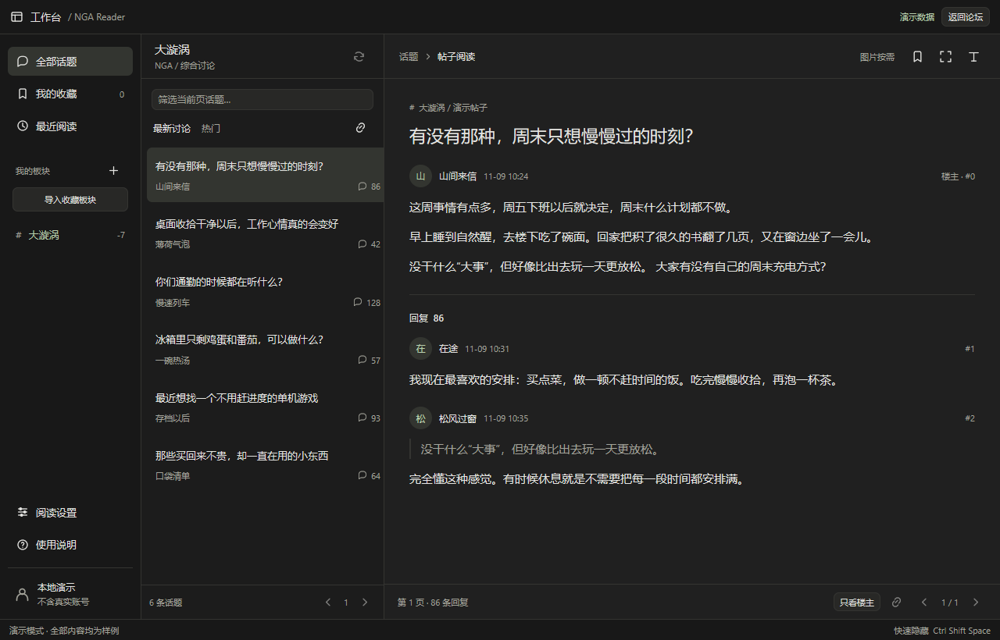
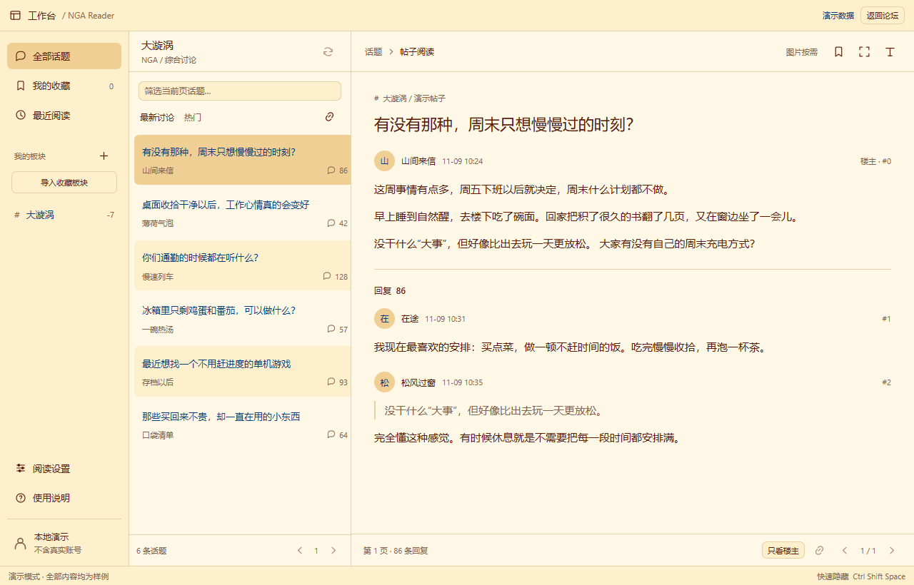

# NGA Reader · 工作台

用 Go 和 [MyGo](https://github.com/egoist/mygo) 编写的 NGA 桌面阅读器。采用类似 Codex 的三栏布局：左侧板块，中间话题列表，右侧正文与回复。

列表和正文由原生 UI 绘制，通过 Go 直接读取论坛数据。官方登录与点击后打开的图片预览使用系统 WebView。

这是独立的非官方项目，与 NGA、OpenAI / Codex 均无隶属关系。

## 下载免安装版

**[打开简洁下载页 → Windows / Mac 免安装版](DOWNLOAD.md)**

当前版本：0.1.8 便携预发布。按系统选择下方 ZIP 即可：

| 系统 | 下载 | 使用方法 |
| --- | --- | --- |
| Windows x64 | [Windows 便携 ZIP](https://github.com/apple-half/nga-reader/releases/download/v0.1.8/NGAReader-0.1.8-Windows-x64-portable.zip) | 解压整个文件夹，双击 `NGAReader.exe` |
| Mac Apple 芯片（M 系列） | [Apple 芯片 ZIP](https://github.com/apple-half/nga-reader/releases/download/v0.1.8/NGAReader-0.1.8-macOS-AppleSilicon-portable.zip) | 解压后打开 `NGAReader.app` |
| Mac Intel | [Intel ZIP](https://github.com/apple-half/nga-reader/releases/download/v0.1.8/NGAReader-0.1.8-macOS-Intel-portable.zip) | 解压后打开 `NGAReader.app` |

无需安装向导或管理员权限。Mac 最低 macOS 12，不强制复制到 Applications。可用 Release 的 `SHA256SUMS.txt` 核对下载内容。程序没有商业代码签名或 Apple 公证，且尚无本版的 360 放行结论，详见下方安全说明。

## 界面预览





截图来自离线演示，账号和帖子内容均为样例。

## 功能

- 三栏阅读、帖子与回复独立分页、只看楼主、专注阅读。
- 已读和有新回复标记；按账号保存最近100条帖子的页码及楼层，重新打开继续阅读。
- 点击页码输入跳转、首页／末页、从头阅读、回到本页顶部；Ctrl／Command + L打开帖子链接。
- 原生文字发帖、普通回复与引用回复，可选择发布板块和主题分类；暂不上传图片。
- 按账号与目标自动保存草稿；发送前保留记录，超时后先核查结果，防止重复发表。
- 导入 NGA 账号收藏的普通板块；本地收藏帖子、最近阅读、自定义板块。
- 深色、浅色、跟随系统，以及「NGA经典屎黄色」主题。
- 图片默认折叠，点击「展示图片」后才请求；关闭预览后释放临时 WebView。
- 官方登录成功后返回阅读器；可选择在本机加密保存会话。
- 个别帖子 JSON 数据不完整时，自动追加一次同站静态正文请求，继续原生阅读；不执行正文网页脚本。
- 侧栏内置离线使用说明；支持 F5 刷新、Ctrl + Shift + Space 隐藏或恢复窗口。
- 启动后自动检查 GitHub 签名更新；有新版时提示，点击后才下载和安装，完成后手动重启。

## 软件更新

0.1.6及更早版本需要手动下载一次新版；0.1.7若检查更新一直显示HTTP403，也请手动下载一次0.1.8。退出旧版，保留原数据目录。正式便携版启动10秒后检查更新，此后每24小时检查；可在侧栏“软件更新”关闭自动检查，或随时手动检查。检查失败可继续阅读。

0.1.8优先读取公开的签名更新索引，再按需使用GitHub Releases API；API限额时提示重试时间和简洁下载页。索引里的安装元数据仍需通过内置公钥验证，不携带NGA登录数据。

发现新版后先查看版本说明，点击“下载并安装”，完成后点击“重启使用新版”。更新只替换程序文件，保留设置、收藏、历史、草稿与待确认发送记录；正在发帖或回复时禁止安装。勾选“记住本机登录”的会话会保存；仅本次运行有效的登录在重启后需要重新登录。

Windows 请保留文件名 `NGAReader.exe`，并放在可写文件夹。Mac 应先从 ZIP 解压后运行；只读或被系统隔离的位置可能无法自动安装，此时按提示手动下载便携包。程序会验证内置公钥对应的 Ed25519 更新签名，该签名用于验证更新来源，不等同于 Windows 代码签名或 Apple 公证。

## 发帖与回复

发帖入口在中栏板块标题旁；普通回复在正文顶部，引用回复在各楼层旁。Enter 只换行，点击发送按钮才发表。关闭编辑器会保留草稿，重新进入同一目标即可恢复；草稿以明文保存在本机 `drafts.json`，请勿公开分享。发送结果待确认时，可以检查后选择“确认已发表，清理草稿”，或确认未发表后解除重复发送保护。完整操作见软件内“使用说明”。

新发帖功能已通过模拟 HTTP 服务和原生界面测试，未代真实账号发布测试帖子；特殊板块、验证码和服务端接口变化仍需实际使用核验。

## 构建与运行

Go 版本以 [go.mod](go.mod) 为准，目前为 **Go 1.27.3**。依赖固定为 MyGo v0.8.3，无需 Node.js、Bun 或 C 编译器。

Windows PowerShell：

```powershell
go mod download
go test ./...
go vet ./...
./build.ps1
./release/NgaReader.exe
```

以上为开发用单文件构建。Windows 设置与本机加密会话保存在 EXE 同级 `data` 目录，文件夹需可写；Mac 保存在 `~/Library/Application Support/NGAReader`，不写入 `.app` 包内。

离线演示：

```powershell
./release/NgaReader.exe --demo
```

可选参数：

| 参数 | 用途 |
| --- | --- |
| `--demo` | 查看明确标注的离线样例，不连接账号 |
| `--data-dir <目录>` | 指定独立数据目录 |
| `--check-api` | 检查未登录接口并输出不含凭据的结果，不创建窗口 |
| `--licenses` | 输出程序内嵌的第三方许可 |

macOS / Linux 交叉编译：

```powershell
./build.ps1 -TargetOS darwin -Arch arm64 -OutputDirectory ./release-mac
./build.ps1 -TargetOS linux -Arch amd64 -OutputDirectory ./release-linux
```

生成含系统图标、文件属性和 Mac App Bundle 的便携发布包：

```powershell
go run github.com/egoist/mygo/cmd/mygo build -platform windows/amd64 -skip-installer -skip-dmg -skip-notarize
python packaging/package.py --target windows-amd64
# Mac 上可将平台改为 darwin/arm64 或 darwin/amd64；target 改为 darwin-arm64 或 darwin-amd64
```

该命令使用 go.mod 固定的 MyGo CLI 版本；Python 只用标准库。正式 Release 工作流在 Windows 和两种芯片的 Mac 环境分别测试、构建和校验，Mac 使用系统 codesign 做 ad-hoc 签名。跨系统编译可生成 App Bundle，但 Mac 签名需在 macOS 上完成。真实账号登录、系统凭据、WebView 验证与完整 GUI 使用仍需真机验证；Linux 不在本次便携 Release 范围。

更新包采用离线签名，私钥不进入仓库或 GitHub Actions。维护者发布步骤见 [发布与签名](packaging/UPDATES.md)；自行构建的分支应使用自己的仓库和密钥。

## 开始阅读

1. 点击「登录 NGA」，在官方页面完成登录。Windows 官方登录和 App 内图片预览需要已有 WebView2 Runtime。
2. 登录成功后返回工作台。左栏选择板块，中栏选择话题，右栏阅读。
3. 点击「我的板块 → 导入收藏板块」导入账号收藏；该操作只读，不修改论坛收藏。
4. 点击每张图片的「展示图片」才会加载图片。图床要求验证时，在预览窗口完成官方验证。

完整操作说明见 [使用说明](resources/usage.md)，也可以在软件侧栏离线查看。

## 数据与安全

默认只保留本次运行的登录。选择「记住本机登录」后，会话使用 AES-GCM 加密保存，密钥保存在系统凭据存储；换电脑通常需要重新登录。请勿上传 `data` 文件夹、Cookie、密码或系统凭据。

官方网页、图床验证及系统代理配置可能引发相应网络请求。本项目遵守论坛登录、权限和频率限制，不提供绕过验证、发帖、投票或批量操作功能。

**杀毒状态：** Windows 0.1.2 构建曾被 360 检出为 `Trojan.Win64.SilverFox.ZAX`。包含 0.1.2 / 0.1.3 样本的复核申请未通过；收到的回复未给出具体检出依据。当前版本为 0.1.8，尚无该版本的 360 放行结论。Windows 程序没有 Authenticode 签名，Mac 只有 ad-hoc 完整性签名，没有 Developer ID 签名或 Apple 公证，系统可能阻止启动。公开源码、功能测试、校验值及依赖漏洞扫描不能替代恶意软件鉴定。详情见 [安全说明](SECURITY.md)。

## 开发与验证

```powershell
go test ./...
go vet ./...
node resources/login-ui.test.cjs
```

Node.js 仅用于可选的登录页脚本测试，构建和运行软件不依赖它。Go 测试使用本地样例与测试服务器，不使用开发者的真实账号会话。

当前回归测试覆盖 API / 静态正文解析、分页、会话加密、登录引导、主题保存、图片按需展示和内置帮助。论坛接口不稳定，复杂视频、部分 BBCode 和表情可能降级显示，可打开原帖查看。

目录说明：

```text
*.go              原生界面、登录和阅读操作
internal/nga/     论坛请求、解析、BBCode 与附件地址处理
internal/local/   本地设置、加密会话与请求取消
internal/appupdate/ GitHub 版本选择、更新签名与安全归档
resources/        内置说明、登录页辅助脚本与第三方许可
LICENSES/         第三方组件的许可原文
docs/images/      离线演示界面图
```

提交问题前请参阅 [贡献说明](CONTRIBUTING.md)，勿附带账号凭据或个人数据。

## 许可与参考

本项目原创代码采用 [MIT License](LICENSE)。第三方代码的许可保留在 [LICENSES](LICENSES) 和程序内嵌的第三方说明中。

收藏板块的接口结构参考 [MNGA 上游实现](https://github.com/BugenZhao/MNGA/blob/main/logic/service/src/forum.rs)，接口格式参考 [NGA API 文档](https://github.com/AgMonk/nga-api-doc/blob/main/README_v2.md)。这些项目分别保留各自许可。
